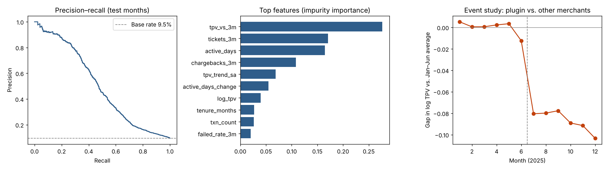

# Merchant Churn – Results

10,000 merchants × 12 months · annual churn 22.7% · label: churned within 3 months · test months Aug–Sep 2025.

## Model (Random Forest + SMOTE)

| Accuracy | Precision | Recall | F1 | ROC-AUC | PR-AUC | Base rate |
|---|---|---|---|---|---|---|
| 0.923 | 0.666 | 0.368 | 0.475 | 0.800 | 0.504 | 9.5% |

## Seasonality vs. product friction (difference-in-differences)

- Friction effect on volume: **-8.3%** (95% CI -9.1% to -7.5%, p = 6.5e-80); true simulated effect -7.7%.
- A naive before/after comparison shows -6.9%, because seasonality and churn are mixed in.
- Pre-trend check: p = 0.16 (no evidence of different trends before July).

## A/B test of the early-warning workflow (simulated outcomes)

- Churn 70.1% (control, n=214) vs. 60.4% (treatment, n=202); z = -2.08, p = 0.038.
- About 20 merchants and $53,506 in annual revenue retained.

